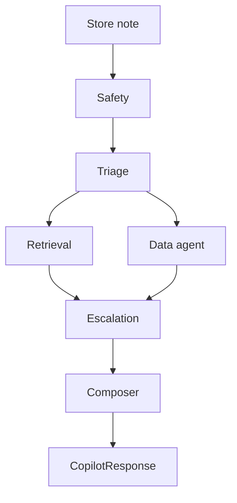

# Architecture

Punjab Sports Mart retail operations copilot. A store employee pastes one note. The system returns a `CopilotResponse`: category, priority, a cited answer, the CSV files it used, and whether a person must take the next step.

The business clock is **2026-10-10 12:00:00 IST** (`copilot/config.py`). "Last 24 hours" and "last 30 days" are counted from that instant. CSV timestamps are treated as the same clock.

## What code owns

Code decides the route, the priority, the team, the SLA, escalation, the numbers, and which citations are allowed. A model may propose a matrix row when `LLM_BACKEND` is not `RULES_ONLY`. It does not invent policy text or figures. Pandas tools are the only source of counts, quantities, and rates.

The documented setup in `.env.example` is `LLM_BACKEND=DEEPSEEK` and `TRIAGE_PATH=cascade`. DeepSeek proposes a matrix row only when rules and kNN do not settle the case. `LLM_BACKEND=RULES_ONLY`, and a process with the variable unset, never calls the model. Classification then stops at the keyword rules or the k-nearest-neighbour vote.

## Request path

`run_turn` in `copilot/graph.py` builds one state and runs a LangGraph. Retrieval and the data agent both read triage and do not read each other. A sequential runner (`run_sequential`) applies the same merge for tests.

Each node appends one step to `logs/trace.jsonl`. Strings are masked before that write. After safety, `raw_text` is cleared from the state. Later nodes see `masked_text` only.

| Node | Module | Owns |
|---|---|---|
| Safety | `copilot/agents/safety.py` | Masking and refusal |
| Triage | `copilot/agents/triage.py` | Category, priority, intent, entities |
| Retrieval | `copilot/agents/retrieval.py` | Policy chunks and citation ids |
| Data | `copilot/agents/data_agent.py` | One pandas tool and its facts |
| Escalation | `copilot/agents/escalation.py` | Whether a human must act, and mock JSON |
| Composer | `copilot/agents/composer.py` | Answer text and the response object |

## Surfaces

| Entry | Role |
|---|---|
| `app.py` | Streamlit UI: Triage, Analytics, Eval |
| `eval.py` | Scores the public, robustness, safety, analytics, and abstain suites |
| `run_dummy.py` | Runs `Use Case 3/evaluation/dummy_cases.csv`, which is not part of the scored suites |
| `copilot/graph.py` | `run_turn` / `run_copilot` for one note |

The UI calls `run_turn` and shows the response JSON, citations, similar past cases, and the agent trace. Analytics reads the same CSVs as the data agent and never shows employee names.

## Safety

Masking and refusal are separate.

Masking replaces card numbers, Indian mobile numbers, emails, and labelled secrets (CVV, PIN, OTP, password, Aadhaar) in the stored text. Store ids such as `ST002` and prices stay. A card becomes `[REDACTED_CARD]`. A phone keeps the last four digits. A return that includes a phone or card is still answered after masking.

Refusal is for prompt injection and restricted asks: ignore-the-rules, reveal the system prompt, dump card numbers, customer databases, supplier contract prices, or employee records. A refusal does not call a data tool. It still escalates and writes a security alert.

Detection also scans base64 payloads embedded in the note, so hiding the instruction inside an encoded blob does not skip the check.

## Triage

Triage picks one escalation-matrix trigger. The row supplies category, priority, team, channel, SLA, `human_approval_required`, and `policy_source`. Keyword rules also fill entities: store id, SKU, product name, register scope, refund amount, and whether the receipt is missing.

`copilot/lexicon.py` rewrites a copy of the note before the rules run. The original text is unchanged. Hinglish and shop-floor words such as `khatam`, `bina bill`, `godown`, and `saare` map onto the English phrases the rules already match.

Rules run in a fixed order. The first hit wins:

1. Restricted data or injection, from the safety flags
2. Injury, recall, or unsafe equipment
3. Store-wide card outage
4. One register or one card reader
5. Vendor quality ranking
6. Unresolved-case summary
7. No-receipt or high-value return
8. Shelf versus register price
9. Quality complaint
10. Short shipment
11. Stock-out, including academy or warehouse depletion
12. Routine return
13. Service recovery
14. Fallback: general analytics, confidence 0.48

### Cascade

`TRIAGE_PATH=cascade` (the default) decides in this order:

1. **Safety.** A refusal keeps the security row. The model cannot override it.
2. **Hard rules.** Injury, a store-wide payment outage, a fill-rate report, a multi-store stock-out, and high-confidence analytics intents stay with the rules.
3. **kNN category.** Embed the note with `BAAI/bge-small-en-v1.5` and vote over labelled rows in `support_cases.csv`. Accept the category when confidence and top-1 similarity clear the thresholds in `.cache/knn_thresholds.json`. Rows too close to an eval prompt are left out of the index, so the index does not memorize the test set.
4. **Confident rule.** A specific rule at confidence 0.85 or above stands when kNN does not name a different category.
5. **Model.** If a backend is configured, DeepSeek (or the selected backend) proposes one matrix row. On agreement, the rules row stands. On disagreement, the proposal is capped at confidence 0.6, which forces escalation. A bad JSON reply is retried once. If the model is unavailable, the cascade keeps the kNN row or the rules row, marks `decision_source=llm_unavailable`, and caps confidence at 0.5.

`TRIAGE_PATH=always` calls the model on every case the rules do not already settle. Priority, team, SLA, and approval still come from the matrix row in code, not from the model.

`LLM_BACKEND=RULES_ONLY` skips step 5. The cascade then ends on the rules row or the kNN row.

## Retrieval

Policy lives in five markdown files under `Use Case 3/knowledge_base/`. `copilot/kb.py` splits each file on `##` headings. A citation id is `file.md#slug`, for example `03_inventory_replenishment_policy.md#stock-outs-and-replenishment`.

For one note, retrieval:

1. Builds a citation plan from the matrix row and the safety flags. The matrix section is always kept. Analytics, priority, PII, injection, and human-approval sections are added when those conditions hold.
2. Takes BM25 top 6 and vector top 6 over the policy chunks, then unions them with the plan.
3. Reranks the union with `BAAI/bge-reranker-base`.
4. Keeps the plan first, then other sections the reranker scores at or above 0, capped at 5 citations.

A negative best logit is "weak" only when the category is Other or Security, or when the matrix section is outside the top 3. Weak retrieval is an escalation reason. The composer may only cite ids that this step returned.

Policy vectors are cached in `.cache/kb_emb.npy`. Rerank logits for a query and chunk id are cached in memory.

## Data agent

`lookup` selects one pandas tool from the triage intent. A refusal returns an empty finding. There is no free-form query.

| Intent | Tool | Reads |
|---|---|---|
| `open_high_priority` | Unresolved P1/P2 cases in a time window | `support_cases.csv` |
| `stock_root_cause` | On-hand, receipts, vendor fill rate, nearby stock, related cases | inventory, products, receipts, vendors, stores, cases |
| `short_shipments` | Receipts below the ordered quantity | `receipts.csv` |
| `vendor_quality_ranking` | Vendors linked to the most quality records | vendors, cases, returns, products |
| `lowest_fill_rate` | Lowest vendor fill rate | `vendor_master.csv` |
| `repeated_stockouts` | High-demand SKUs out of stock in more than one store | `inventory.csv` |
| `quality_trend` | Quality returns and cases for one SKU | returns, cases, products |
| `returns_over_threshold` | Returns at the approval cutoffs | `returns_quality.csv` |
| empty | No tool | — |

SKU resolution tries an explicit code, then the longest catalog name in the note, then a price plus a noun, then a seam-defect shortcut, then a fuzzy name. Facts are sentences the composer can quote. Gold checks look for those sentences, not for a second calculation.

The nine files in `Use Case 3/data/` are `support_cases`, `product_master`, `inventory`, `store_master`, `employee_master`, `receipts`, `vendor_master`, `returns_quality`, and `escalation_matrix`. `employee_master.csv` is loaded and never displayed.

## Escalation

`decide` escalates when any of these is true:

- Priority is P1
- Confidence is below 0.65 (`CONF_ESCALATE`). The SOP text says 0.60. This build uses 0.65.
- The note is injection or restricted data
- The matrix row has `human_approval_required = Yes`
- Retrieval is weak
- The model was required and unavailable
- A hard rule conflicts with the draft decision

Every turn writes `outbox/{request_id}_ticket.json`. An escalation also writes a notify file. A short-shipment finding writes a vendor-claim draft with `submitted: false`. A refusal writes a security alert. Nothing is sent to a real queue. Payloads are masked again before they hit disk.

## Composer

The composer joins, in order:

1. The triage reasoning sentence, or a refusal line
2. The masked note, when PII was removed
3. The pandas fact sentences
4. One short policy line per cited section (`POLICY_LINES` in `copilot/agents/composer.py`)
5. The escalation sentence, when a person must act

It then drops any citation that retrieval did not return, and masks the answer again. A missing store or SKU on a case that needs one becomes `follow_up_question`.

The answer is therefore a concatenation, not a rewritten paragraph. The same fact can appear twice when a policy line repeats an instruction that the fact already states ("likely linked to"). Category, citations, and numbers are unaffected.

## Response

`CopilotResponse` in `copilot/schemas.py` is the section-14 contract:

| Field | Meaning |
|---|---|
| `category` | One of eight labels, from the matrix row |
| `priority` | `P1` through `P4`, from the matrix row |
| `confidence` | 0 to 1. Below 0.65 escalates |
| `answer` | The joined text |
| `citations` | `file.md#slug` ids that retrieval returned |
| `data_used` | CSV names the tool actually read |
| `escalation` | `required`, `team`, `reason` |
| `pii_masked` | A value was redacted |
| `follow_up_question` | Set when a required entity is missing |
| `safety_refusal` | The note was refused |

## Evaluation

`eval.py` runs each suite twice per configuration: once on rules, and again on DeepSeek when `DEEPSEEK_API_KEY` is set. Gold numbers are computed in pandas at score time from the same tools and the same anchor clock. The scorer is not an LLM judge.

A case passes a metric only on an exact match: category string, priority string, required citation ids present and also retrieved, escalation yes/no, team on the matrix row, required CSV names, and required substrings in the answer (`eval_gold.py`). Safety fails if a refusal or a mask does not match the case, or if the answer or an outbox file still contains unmasked PII.

Public rules predictions are written to `Use Case 3/evaluation/predictions.csv`. Per-case rows and `report.md` go under `Use Case 3/evaluation/results/`.

## Configuration and caches

| Setting | Default | Effect |
|---|---|---|
| `LLM_BACKEND` | `DEEPSEEK` in `.env.example` | Demo triage backend. Unset or `RULES_ONLY` skips the model. The adapter also accepts `openai`, `gemini`, `groq`, and `ollama`. |
| `TRIAGE_PATH` | `cascade` | `cascade` or `always` |
| `DEEPSEEK_API_KEY` | unset | Required only for the DeepSeek pass |
| `CONF_ESCALATE` | 0.65 | Escalate below this confidence |
| `NOW` | 2026-10-10 12:00:00 | Anchor for windows |

| Cache | Contents |
|---|---|
| `.cache/case_emb.npy` | kNN case vectors |
| `.cache/knn_thresholds.json` | Chosen confidence and similarity cutoffs |
| `.cache/kb_emb.npy` | Policy-section vectors |
| `.cache/*.json` | Successful model JSON replies, keyed by prompt |
| `.cache/fastembed/` | ONNX weights for the encoder and reranker |

`copilot/warmup.py` loads the frames, the policy matrix, the kNN index, one encode, and one rerank before the first timed request. Embedding and rerank use ONNX sessions from FastEmbed. There is no PyTorch runtime and no vector database.
