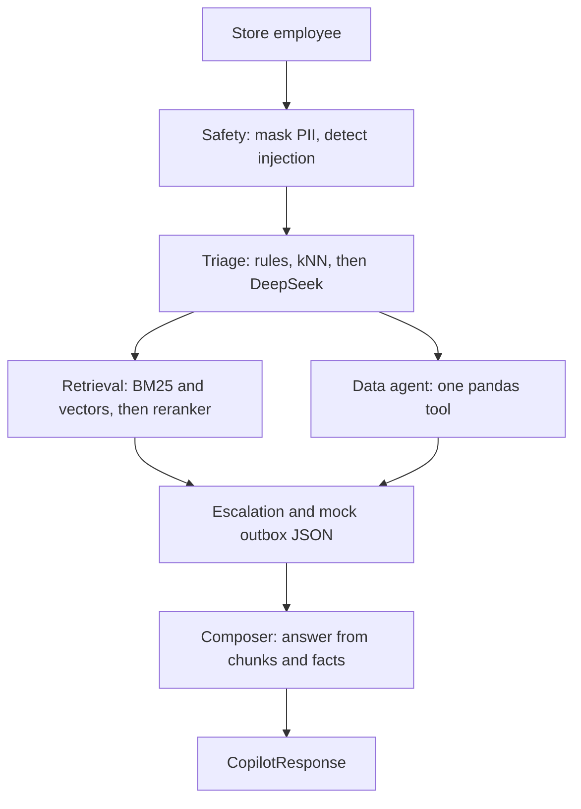

# Punjab Sports Mart — Retail Operations Copilot

Retail operations copilot for the HCLTech UC3 hackathon. It classifies a store note, cites the knowledge base, reads the CSVs, and writes `predictions.csv`.

The demo calls DeepSeek for triage when keyword rules and the case index do not settle a note. DeepSeek proposes one escalation-matrix row. It does not write the answer. The composer builds that text from the triage sentence, the pandas facts, and one policy line per citation.

Full architecture notes are in [ARCHITECTURE.md](ARCHITECTURE.md). The business clock is **2026-10-10 12:00:00 IST**.

## Setup

Requires [uv](https://docs.astral.sh/uv/) and GNU make. `make setup` installs Python 3.11 into `.venv`.

```bash
make setup
make run
```

If `.env` is missing, copy `.env.example` to `.env` and put `DEEPSEEK_API_KEY` in it before `make run`. `.env.example` sets `LLM_BACKEND=DEEPSEEK` and `TRIAGE_PATH=cascade`. The model is `deepseek-chat` at temperature 0. A bad JSON reply is retried once. If the call still fails, triage keeps the rules or kNN row, marks the decision unavailable, and caps confidence at 0.5. Successful replies are cached under `.cache/`.

`LLM_BACKEND=RULES_ONLY` is the offline fallback. It never calls DeepSeek. Reworded notes then depend on keywords and the case index, and most robustness cases miss. Leave the example value as `DEEPSEEK` for a demo.

`make test` runs the pytest checks for masking and citation ids. `make eval` scores the suites.

## What `make eval` does

Scores public, robustness, safety, analytics, and abstain on rules, then again on DeepSeek when `DEEPSEEK_API_KEY` is set. `make eval SUITE=public` scores one suite. Public predictions stay in `Use Case 3/evaluation/predictions.csv`. Per-case rows and `report.md` are written under `Use Case 3/evaluation/results/`.

## Architecture

Code decides the route, the priority, escalation, the numbers, and which citations are valid. DeepSeek may propose the matrix row. It must not invent policy or figures. The longer write-up, including the cascade order and the data tools, is [ARCHITECTURE.md](ARCHITECTURE.md).



Retrieval unions BM25 top 6 with vector top 6 (`BAAI/bge-small-en-v1.5`), adds the citation plan, and reranks with `BAAI/bge-reranker-base`. The composer may cite only ids that step returned.

Masking happens before the trace log is written. A refusal is separate from masking: a card pasted onto a return is redacted and the return is still answered. A request to reveal card numbers or ignore the rules is refused and escalated.

Escalation is required when priority is P1, confidence is below 0.65, the request is injection or restricted data, or the chosen matrix row has `human_approval_required = Yes`. The SOP text says 0.60; this build uses the 0.65 setting in `copilot/config.py`.

Mock tickets, notifications, and draft vendor claims are JSON files under `outbox/`. Nothing is submitted to a real system.

## Layout

| Path | Role |
|---|---|
| `ARCHITECTURE.md` | Request path, cascade, retrieval, tools, response contract |
| `copilot/config.py` | Paths, anchor time, cutoffs |
| `copilot/schemas.py` | Pydantic models, including the section 14 response |
| `copilot/llm.py` | DeepSeek JSON adapter, temperature 0, one retry, `.cache/` replay. Also speaks the OpenAI, Gemini, Groq, and Ollama APIs |
| `copilot/kb.py` | `##` chunks, ids like `file.md#slug`, BM25 |
| `copilot/embed.py` | Policy and case vectors, plus the reranker |
| `copilot/data.py` | Nine CSVs and the named pandas tools |
| `copilot/agents/` | Safety, triage, retrieval, data, escalation, composer |
| `copilot/graph.py` | LangGraph fan-out, plus a sequential runner |
| `copilot/trace.py` | `logs/trace.jsonl` |
| `eval.py` | Suite predictions and metrics |
| `app.py` | Streamlit triage, dashboard, and eval report |

## Limitations

- The answer is joined from the triage sentence, pandas facts, and one policy line per citation. DeepSeek classifies. It does not rewrite that paragraph.
- `LLM_BACKEND=RULES_ONLY` never calls the model. Keyword rules miss phrasings that are not in the public set.
- Employee names are loaded with `employee_master.csv` and are not shown.
- Hidden judge prompts are not in this eval.
