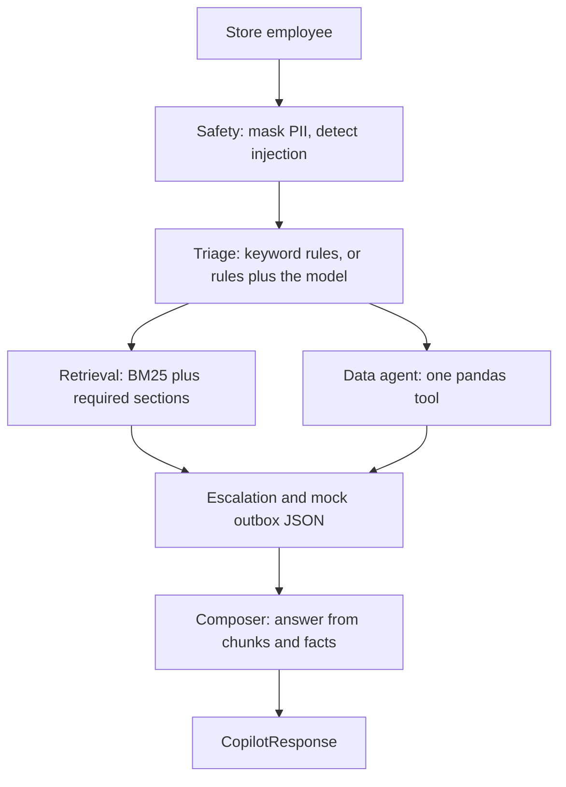

# Punjab Sports Mart — Retail Operations Copilot

Retail operations copilot for the HCLTech UC3 hackathon. It classifies a store note, cites the knowledge base, reads the CSVs, and writes `predictions.csv`. `LLM_BACKEND=RULES_ONLY` is the default and does not call a model. Set `DEEPSEEK_API_KEY` in `.env` when you want the DeepSeek triage pass.

The business clock is **2026-10-10 12:00:00 IST**.

## Setup

Requires [uv](https://docs.astral.sh/uv/) and GNU make. `make setup` installs Python 3.11 into `.venv`.

```bash
make setup
make eval
make run
```

`make test` runs the pytest checks for masking and citation ids.

Copy `.env.example` to `.env` and set `DEEPSEEK_API_KEY` for the model pass. Leave `LLM_BACKEND=RULES_ONLY` if you want the app itself to stay on rules. The DeepSeek model is `deepseek-chat` at temperature 0. A bad JSON reply is retried once, then triage keeps the rules result. Successful replies are cached under `.cache/`.

## What `make eval` does

Scores public, robustness, safety, analytics, and abstain on rules, then again on DeepSeek when `DEEPSEEK_API_KEY` is set. `make eval SUITE=public` scores one suite. Rules predictions for the public cases stay in `Use Case 3/evaluation/predictions.csv`. Per-case rows and `report.md` are written under `Use Case 3/evaluation/results/`.

## Architecture

Code decides the route, the priority, escalation, the numbers, and which citations are valid. A later step can let the model classify messy text and phrase an answer from the same evidence. It must not invent policy or figures.



Masking happens before the trace log is written. A refusal is separate from masking: a card pasted onto a return is redacted and the return is still answered. A request to reveal card numbers or ignore the rules is refused and escalated.

Escalation is required when priority is P1, confidence is below 0.65, the request is injection or restricted data, or the chosen matrix row has `human_approval_required = Yes`. The SOP text says 0.60; this build uses the 0.65 setting in `copilot/config.py`.

Mock tickets, notifications, and draft vendor claims are JSON files under `outbox/`. Nothing is submitted to a real system.

## Layout

| Path | Role |
|---|---|
| `copilot/config.py` | Paths, anchor time, cutoffs |
| `copilot/schemas.py` | Pydantic models, including the section 14 response |
| `copilot/llm.py` | OpenAI, Gemini, Groq, or Ollama JSON adapter, with a `.cache/` replay |
| `copilot/kb.py` | `##` chunks, ids like `file.md#slug`, BM25 |
| `copilot/data.py` | Nine CSVs and the named pandas tools |
| `copilot/agents/` | Safety, triage, retrieval, data, escalation, composer |
| `copilot/graph.py` | LangGraph fan-out, plus a sequential runner |
| `copilot/trace.py` | `logs/trace.jsonl` |
| `eval.py` | Public and robustness predictions and metrics |
| `app.py` | Streamlit triage, dashboard, eval stub |

## Limitations

- Keyword rules will miss phrasings that are not in the public set.
- The wording is templated from the retrieved sections. The model adapter is not wired into the agents yet.
- Employee names are loaded with `employee_master.csv` and are not shown.
- Hidden judge prompts are not in this eval.
